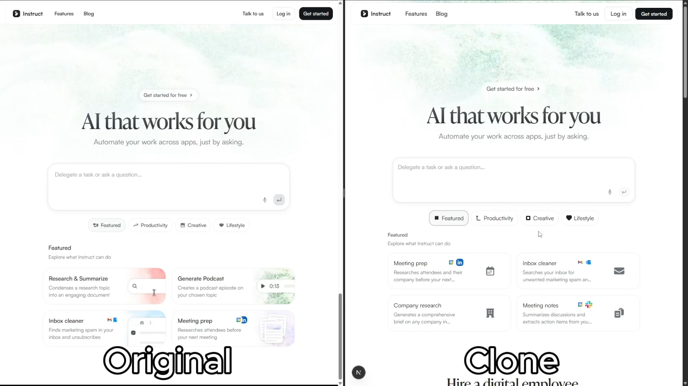

# AI Website Cloner Template

<a href="https://github.com/JCodesMore/ai-website-cloner-template/blob/master/LICENSE"></a> <a href="https://github.com/JCodesMore/ai-website-cloner-template/stargazers"></a> <a href="https://discord.gg/hrTSX5yTpB"></a>

這是一個可重複使用的專案範本，能透過 AI 程式開發代理（AI coding agents）將任何網站逆向工程並重建為乾淨、現代化的 Next.js 程式碼庫 —— **支援執行階段（runtime）JS 動畫攔截**，讓 GSAP、ScrollTrigger、Lenis 等動態效果在複製後依然完整保留。

目前主要維護的代理整合為 Claude Code 與 Codex；其他代理工具則可參考 `AGENTS.md` 中的通用指引。

只要指定目標網址並執行 `/clone-website`，AI 代理就會自動檢視網站、擷取設計 Token 與靜態資源、**在執行階段攔截頁面的動畫函式庫以記錄每個 Tween 的目標、緩動（easing）、持續時間與觸發條件**、撰寫元件規格，並平行派發建置代理（builder agents）還原每個區塊。

## 本版本的獨特之處

多數網站逆向工程流程只停留在 CSS 層面。它們能取得色彩、間距與字體 —— 但產出的複製網站往往顯得生硬死板，因為所有隨捲動觸發的淡入、視差（parallax）與固定區塊（pinned section）都消失了。這些動態邏輯存在於編譯後的 JS 套件而非樣式表中，靜態檢查無法看見。

本範本會**在頁面自身程式碼執行前，於執行階段攔截動畫函式庫**並記錄每一次呼叫：

- **偵測**頁面載入的動畫函式庫 —— GSAP、ScrollTrigger、Lenis、Locomotive Scroll、Framer Motion、AOS、Swiper、Three.js
- **透過 `addInitScript` 攔截 GSAP**，在頁面啟動前包裝 `gsap.to/from/fromTo/set/timeline` 與 `ScrollTrigger.create`
- **單次掃描擷取**所有樣式表中的 `@keyframes` 規則
- **重播頁面**（重新載入並完整捲動），讓所有進場動畫與捲動觸發的 Tween 都寫入攔截器
- **完整序列化輸出**至 `docs/sites/<hostname>/research/animation-libraries.json` —— 包含精確目標、`vars`（緩動、持續時間、scrub、觸發起迄點）以及時間戳記

派發建置代理時，協調器（orchestrator）會將該 JSON 依各區塊的選擇器過濾，並直接內嵌進提示詞（prompt）中 —— 因此建置代理能精確重現 `ease: "power3.out"`、`start: "top 80%"`、`scrub: true`，而不必靠猜測。

## 示範影片

[](https://youtu.be/O669pVZ_qr0)

> 點擊上方圖片前往 YouTube 觀看完整示範。

## 快速開始

> **重要提醒：** 請先使用 GitHub 上的 **Use this template** 按鈕建立屬於你自己的複製專案。請勿直接 clone 此範本儲存庫來製作你的網站專案，也不要將產生的網站透過 Pull Request 送回此範本儲存庫。

1. **從此範本建立你自己的儲存庫**

   在此專案的 GitHub 頁面上，點擊 **Use this template**，接著點擊 **Create a new repository**。

   為新儲存庫命名、選擇公開（Public）或私人（Private），然後點擊 **Create repository**。如果 GitHub 顯示 **Include all branches** 選項，可以不用勾選。

   這樣你就能在獨立的專案中作業，網站的修改會留在你自己的帳號下，而不會回到主範本。

2. **在你的電腦上開啟新儲存庫**

   GitHub 建立完成後，開啟該新儲存庫。點擊 **Code**，並使用你慣用的開發工具開啟或 clone 該儲存庫。

   如果使用終端機，指令會像這樣：

   ```bash
   git clone https://github.com/YOUR-USERNAME/YOUR-NEW-REPOSITORY.git
   cd YOUR-NEW-REPOSITORY
   ```

3. **安裝相依套件**
   ```bash
   npm install
   ```
4. **啟動 AI 代理** —— 建議使用 Claude Code：
   ```bash
   claude --chrome
   ```
5. **執行 Skill**：
   ```
   /clone-website <target-url1> [<target-url2> ...]
   ```
6. **客製化調整**（選用）—— 在基礎複製網站建置完成後，依需求自由修改。

> 使用 Codex 嗎？直接執行同樣的 `/clone-website` skill 即可。其他代理工具則可讀取 `AGENTS.md` 與主工作流程 skill。

## 支援平台

| 代理工具 | 整合方式 |
| -------- | -------- |
| [Claude Code](https://docs.anthropic.com/en/docs/claude-code) | 正式規格 `.claude/skills/clone-website/SKILL.md` 與 `CLAUDE.md` |
| [Codex CLI](https://github.com/openai/codex) | 由腳本同步產生的 `.codex/skills/clone-website/SKILL.md` 與 `AGENTS.md` |

## 前置需求

- [Node.js](https://nodejs.org/) 24+
- 瀏覽器自動化 MCP —— **建議使用 Chrome MCP**（執行階段動畫攔截 Hook 所需）。Playwright MCP、Browserbase 或 Puppeteer MCP 只要提供類似 `addInitScript`、可在頁面腳本執行前注入的功能亦可運作。
- AI 程式開發代理（見[支援平台](#支援平台)）

## 技術堆疊

- **Next.js 16** — App Router、React 19、嚴格模式 TypeScript
- **shadcn/ui** — Radix 原語（primitives）+ Tailwind CSS v4
- **Tailwind CSS v4** — oklch 設計 Token
- **Lucide React** — 預設圖示庫（複製網站過程中會替換為擷取的 SVG）

## 運作原理

`/clone-website` skill 會執行多階段管線流程：

1. **偵察與資料蒐集（Reconnaissance）** — 頁面截圖、設計 Token 擷取、互動掃描（捲動、點擊、懸停、響應式斷點）
2. **JS 動畫攔截（JS animation interception）** — 辨識已載入的動畫函式庫、匯出所有 `@keyframes` 規則，並透過 `addInitScript` 注入 GSAP/ScrollTrigger Hook，只需一次重新載入加上完整捲動，即可將每個 Tween 的 `target`、`vars` 與時間戳記記錄至 `docs/sites/<hostname>/research/animation-libraries.json`
3. **基礎架構建置（Foundation）** — 更新字體、色彩、全域樣式，並下載所有靜態資源
4. **元件規格撰寫（Component Specs）** — 撰寫詳細的規格文件（`docs/sites/<hostname>/specs/`），包含精確的計算後 CSS 數值、狀態、互動行為與真實內容
5. **平行建置（Parallel Build）** — 在獨立的 git worktree 中平行派發建置代理，每個區塊或元件一個代理，並將對應的動畫呼叫直接內嵌至提示詞中
6. **組裝與品質驗證（Assembly & QA）** — 合併各個 worktree、串接完整頁面，並與原始網站進行視覺比對檢查

每個建置代理都會直接取得完整的元件規格 —— 精確的 `getComputedStyle()` 數值、互動模型、多狀態內容、響應式斷點、資源路徑，**以及針對該區塊 DOM 的精確 GSAP/ScrollTrigger 呼叫參數**，完全無需臆測。

### 動畫擷取細節

攔截器實作於 `.claude/skills/clone-website/SKILL.md` 的 Phase 1，包含三個協同步驟：

```javascript
// 1. Fingerprint loaded libraries
JSON.stringify({
  gsap: window.gsap ? { version: window.gsap.version } : false,
  scrollTrigger: !!(window.ScrollTrigger || window.gsap?.ScrollTrigger),
  lenis: !!(window.Lenis || window.lenis),
  locomotiveScroll: !!(window.LocomotiveScroll || window.locomotive),
  framerMotion: !!document.querySelector('[data-framer-motion],[data-projection-id]'),
  aos: !!(window.AOS || document.querySelector('[data-aos]')),
  swiper: !!(window.Swiper || document.querySelector('.swiper')),
  three: !!(window.THREE || document.querySelector('canvas')),
});

// 2. Inject BEFORE the page boots (addInitScript) — wrap gsap.to/from/fromTo/set/timeline
//    and ScrollTrigger.create so every call is recorded into window.__gsapCalls.

// 3. Reload, scroll the full page, then read back window.__gsapCalls.
```

輸出會是結構化的 JSON 紀錄，範例如下：

```json
{
  "detected": { "gsap": { "version": "3.12.5" }, "scrollTrigger": true },
  "cssKeyframes": [
    { "name": "fadeUp", "keyframes": [{ "key": "0%", "styles": "opacity: 0; transform: translateY(20px)" }] }
  ],
  "calls": [
    { "method": "to", "target": ".hero-title", "vars": { "y": 0, "opacity": 1, "duration": 1, "ease": "power3.out" } },
    { "method": "create", "target": ".case-list", "vars": { "trigger": ".case-list", "start": "top 80%", "scrub": true } }
  ]
}
```

如果未偵測到任何 JS 動畫函式庫，系統仍會寫入該檔案，其中 `detected` 旗標皆為 `false`、`calls` 為空陣列 —— 後續階段會無條件讀取此檔案。

## 適用情境

- **平台遷移** — 將你擁有的 WordPress / Webflow / Squarespace 網站重建為現代化的 Next.js 程式碼庫，**同時完整保留花費數週微調的 GSAP 時間軸動畫**
- **原始碼遺失** — 網站仍在線上運作，但儲存庫遺失、開發者已離職或技術棧過舊時，將網站還原為現代化格式並保留動畫效果
- **技術學習與拆解** — 透過真實程式碼與擷取到的動畫紀錄，拆解正式上線網站如何實作特定的捲動驅動版面、固定區塊與視差效果

## 不適用情境

- **網路釣魚或冒充他人** — 嚴禁將本專案用於欺騙、冒充或任何違法行為。
- **將他人設計據為己有** — Logo、品牌資產與原創文案均歸原權利人所有。
- **違反服務條款** — 部分網站明確禁止抓取或重製，使用前請先確認目標網站規範。

## 專案結構

### 範本根目錄（產生器）

這是你 clone 下來並執行 `/clone-website` 的範本專案，包含產生器所需的基礎架構：

```
src/
  app/              # Next.js 路由（範本）
  components/       # React 元件（範本）
    ui/             # shadcn/ui 原語元件
    icons.tsx       # 擷取的 SVG 圖示元件（範本）
  lib/utils.ts      # cn() 工具函式
  types/            # TypeScript 型別介面
  hooks/            # 自訂 React Hooks
public/
  images/           # 從目標網站下載的圖片（範本）
  videos/           # 從目標網站下載的影片（範本）
  seo/              # Favicon、OG 圖片（範本）
docs/
  guides/                      # 可重複使用的網站檢視指南
  sites/<hostname>/            # 既有的網站擷取範例紀錄
openspec/                      # 產品與工作流程規格及變更紀錄
.agents/skills/                # OpenSpec 工作流程 skills
.claude/skills/clone-website/  # 主要的網站複製工作流程 skill
.codex/skills/clone-website/   # 同步產生的 Codex 版本 skill
scripts/
  init-export-project.mjs      # 初始化獨立的匯出專案
  sync-skills.mjs              # 重新產生 Codex 版 clone skill
AGENTS.md           # 代理指令（單一事實來源）
CLAUDE.md           # Claude Code 設定（直接匯入 AGENTS.md）
```

### 匯出專案（產生的複製網站）

每個複製出來的網站都會成為 `export/<site-id>/` 底下的**獨立 Next.js 專案**。這些專案完整且自給自足，可獨立移動、部署或封存：

```
export/
  example.com/                    # 由網址正規化產生的 Site ID
    src/
      app/                        # Next.js 路由（複製網站）
      components/                 # React 元件（複製網站）
        ui/                       # shadcn/ui 原語元件
        icons.tsx                 # 擷取的 SVG 圖示
      lib/utils.ts                # cn() 工具函式
      types/                      # TypeScript 型別介面
      hooks/                      # 自訂 React Hooks
    public/
      images/                     # 下載的圖片
      videos/                     # 下載的影片
      seo/                        # Favicon、OG 圖片
    docs/
      sites/example.com/
        research/                 # 調查結果與動畫擷取紀錄
        specs/                    # 各元件規格文件
        screenshots/              # 視覺參考與比對截圖
    scripts/                      # 網站資源輔助腳本（選用）
    package.json                  # 獨立的 package.json
    package-lock.json
    tsconfig.json
    next.config.ts
    postcss.config.mjs
    eslint.config.mjs
    components.json
    README.md                     # 該網站專屬說明文件
    export-manifest.json          # 中繼資料（來源網址、建立日期等）
    .gitignore
  another-site.com--products/     # 另一個複製網站（不同路徑）
```

**重點說明：**
- 每個 `export/<site-id>/` 都是完整的 Next.js 專案 —— 在該目錄內直接執行 `npm install && npm run dev` 即可啟動
- 範本根目錄（頂層的 `src/`、`public/`、`docs/`）**僅作為產生器使用** —— 新的複製專案不會更動到範本根目錄
- 多個複製網站彼此完全隔離 —— 沒有共用檔案，也不會互相衝突
- 匯出專案**不會提交至 git**（詳見 `.gitignore`）—— 它們屬於建置產出物
- 若要交付某個複製網站，只需壓縮或複製整個 `export/<site-id>/` 資料夾即可

## 常用指令

### 範本根目錄（產生器）

```bash
npm run dev       # 啟動開發伺服器（範本）
npm run build     # 建置正式環境版本（範本）
npm run lint      # ESLint 檢查
npm run typecheck # TypeScript 型別檢查
npm run check     # 依序執行 lint + typecheck + build
```

### 匯出專案（已複製的網站）

執行 `/clone-website` 後，每個網站會位於 `export/<site-id>/`：

```bash
cd export/<site-id>
npm install           # 安裝相依套件（僅首次需要）
npm run dev           # 於 localhost:3000 啟動開發伺服器
npm run build         # 建置正式環境版本
npm run lint          # ESLint 檢查
npm run typecheck     # TypeScript 型別檢查
npm run check         # 依序執行 lint + typecheck + build
```

### 使用 Docker

```bash
docker compose up app --build # 建置並執行正式環境容器
docker compose up dev --build # 以開發模式於 port 3001 啟動
```

## 匯出工作流程

當你執行 `/clone-website <url1> [<url2> ...]` 時，流程如下：

1. **產生 Site ID** — 每個網址會被正規化為適合檔案系統使用的 Site ID：
   - `https://example.com` → `example.com`
   - `https://example.com/products/item` → `example.com--products-item`
   - `https://example.com/search?q=test` → `example.com--search--<hash>`

2. **衝突偵測** — 若 `export/<site-id>/` 已存在，skill 會回報衝突並在覆寫前詢問確認；使用 `--force` 可強制覆寫。

3. **初始化專案** — 系統會在 `export/<site-id>/` 建立完整的 Next.js 專案，從範本複製所有設定檔、原始碼與目錄結構。

4. **在匯出專案內進行複製** — 所有擷取、建置與驗證都會在 `export/<site-id>/` 內執行，不會動到範本根目錄。

5. **建置驗證** — 複製完成後，會在匯出專案內執行 `npm run check`，確認能乾淨通過檢查與建置。

6. **結果回報** — Skill 會回報匯出專案的路徑與啟動指令。

### 移動或交付複製專案

每個匯出專案都可獨立運作，分享或部署的方式如下：

```bash
# 複製到其他位置
cp -r export/example.com /path/to/destination/

# 或壓縮後交付
zip -r example.com-clone.zip export/example.com

# 接收端只需執行：
cd example.com
npm install
npm run dev
```

完全不依賴原本的範本 —— 匯出專案已包含所需的一切檔案。

## 更新代理指引與 Skill

`AGENTS.md` 是專案指引的單一事實來源；`CLAUDE.md` 直接匯入該檔案，而 Codex 則直接讀取它。網站複製流程的主要規格位於 `.claude/skills/clone-website/SKILL.md`，編輯後請執行以下指令重新產生 Codex 版本：

```bash
node scripts/sync-skills.mjs
```

`.agents/skills/` 存放 OpenSpec skills，並由 OpenSpec 管理；`docs/guides/` 包含可重複使用的網站檢視指南。新的複製網站應放置在 `export/<site-id>/`，其擷取紀錄位於 `export/<site-id>/docs/sites/<hostname>/`。既有的 COUNTER 範例則保留在 `docs/sites/counter-digital.jp/`。

## Star History

[](https://star-history.com/#JCodesMore/ai-website-cloner-template&Date)

## 授權條款

MIT
